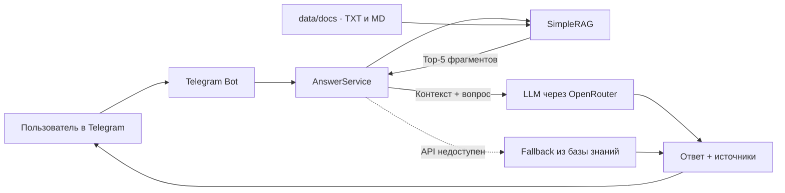

<div align="center">

# Support RAG Bot

### Telegram-ассистент первой линии поддержки для бизнеса

Бот находит релевантные инструкции в локальной базе знаний и формирует короткий ответ с помощью LLM — с опорой на источники и безопасным fallback-режимом.

[](https://www.python.org/)
[](https://core.telegram.org/bots/api)
[](https://openrouter.ai/)
[](#как-это-работает)
[](#статус-проекта)

</div>

---

## О проекте

**Support RAG Bot** — учебный MVP системы автоматизации клиентской поддержки для компаний, которые работают с онлайн-кассами, ОФД, фискальными накопителями, маркировкой и бухгалтерскими услугами.

Вместо ответа «из памяти» модель получает только релевантные фрагменты внутренней базы знаний. Такой подход делает ответы предметнее, позволяет показывать источники и снижает риск галлюцинаций.

### Что демонстрирует проект

- полный RAG-пайплайн: загрузка документов → разбиение на чанки → поиск → генерация ответа;
- асинхронную интеграцию Telegram Bot API и OpenRouter;
- собственный легковесный retrieval без векторной БД и внешнего индекса;
- контекст диалога для уточняющих вопросов;
- деградацию без падения: при отсутствии API-ключа или ошибке LLM бот возвращает найденные фрагменты;
- обновление базы знаний без перезапуска через команду `/reload`;
- CLI-режим для быстрой локальной проверки без Telegram.

## Как это работает



1. Документы из `data/docs` разбиваются на перекрывающиеся фрагменты.
2. Для каждого фрагмента строится частотный вектор символьных n-грамм.
3. Запрос сравнивается с базой по cosine similarity; выбираются пять лучших совпадений.
4. Найденный контекст и последние сообщения диалога передаются модели через OpenRouter.
5. Бот отправляет ответ в Telegram и, при включённой настройке, указывает локальные источники.

> Для retrieval не нужны embeddings, отдельная БД или платный API. Индекс строится в памяти при запуске и подходит для небольшой базы знаний и MVP.

## Возможности

| Возможность | Реализация |
|---|---|
| Поиск по базе знаний | Символьные n-граммы 3–5 символов + cosine similarity |
| Поддерживаемые документы | `.txt`, `.md` |
| Генерация ответа | Любая совместимая модель из каталога OpenRouter |
| История диалога | Последние 4 сообщения передаются модели |
| Источники | Имена использованных файлов добавляются к ответу |
| Отказоустойчивость | Локальный fallback при отсутствии ключа или ошибке OpenRouter |
| Интерфейсы | Telegram-бот и интерактивный CLI |
| Обновление знаний | Команда `/reload` без перезапуска процесса |

## Стек

- **Python 3.10+**
- **python-telegram-bot 21** — Telegram Bot API и polling
- **httpx** — асинхронные запросы к OpenRouter
- **python-dotenv** — конфигурация через переменные окружения
- **Beautiful Soup + Requests** — опциональная загрузка текстов из открытых источников
- **Собственный RAG-модуль** — chunking, n-граммы, cosine similarity и ранжирование

## Структура проекта

```text
support_rag_bot/
├── app/
│   ├── answer_service.py    # оркестрация retrieval, LLM и fallback
│   ├── config.py            # настройки приложения и .env
│   ├── openrouter_client.py # асинхронный клиент OpenRouter
│   └── rag.py               # загрузка, chunking и поиск по документам
├── data/
│   ├── docs/                # локальная база знаний
│   └── source_urls.txt      # список открытых источников
├── scripts/
│   └── scrape_urls.py       # опциональный сбор текста со страниц
├── bot.py                   # Telegram-интерфейс
├── cli_test.py              # локальный интерактивный режим
├── requirements.txt
└── .env.example
```

## Быстрый старт

### 1. Клонировать проект

```bash
git clone https://github.com/Shira-Artem/Support-RAG-Bot.git
cd support-rag-bot
```

### 2. Создать окружение и установить зависимости

<details open>
<summary><b>Windows PowerShell</b></summary>

```powershell
py -m venv .venv
.\.venv\Scripts\Activate.ps1
python -m pip install -r requirements.txt
Copy-Item .env.example .env
```

</details>

<details>
<summary><b>macOS / Linux</b></summary>

```bash
python3 -m venv .venv
source .venv/bin/activate
python -m pip install -r requirements.txt
cp .env.example .env
```

</details>

### 3. Настроить переменные окружения

Создайте Telegram-бота через [@BotFather](https://t.me/BotFather), получите ключ на странице [OpenRouter Keys](https://openrouter.ai/keys) и заполните `.env`:

```env
TELEGRAM_BOT_TOKEN=your_telegram_bot_token
OPENROUTER_API_KEY=your_openrouter_api_key
OPENROUTER_MODEL=openrouter/auto
APP_NAME=Support RAG Bot
APP_URL=http://localhost
SHOW_SOURCES=1
```

| Переменная | Обязательна | Назначение |
|---|:---:|---|
| `TELEGRAM_BOT_TOKEN` | Для Telegram | Токен, полученный у BotFather |
| `OPENROUTER_API_KEY` | Нет | Без ключа используется локальный fallback |
| `OPENROUTER_MODEL` | Нет | Модель OpenRouter; по умолчанию `openrouter/auto` |
| `APP_NAME` | Нет | Название приложения в заголовках OpenRouter |
| `APP_URL` | Нет | URL приложения в заголовках OpenRouter |
| `SHOW_SOURCES` | Нет | `1` — добавлять источники к ответу, `0` — скрывать |

### 4. Проверить retrieval и ответы в CLI

```bash
python cli_test.py
```

Примеры запросов:

```text
не уходят чеки в ОФД
ошибка ФН 234
как заменить фискальный накопитель
что такое маркировка
нужна бухгалтерия для ИП
```

Для выхода введите `exit`.

### 5. Запустить Telegram-бота

```bash
python bot.py
```

На Windows также можно использовать `run_bot.bat`.

## Команды бота

| Команда | Описание |
|---|---|
| `/start` | Приветствие и примеры вопросов |
| `/sources` | Список файлов локальной базы знаний |
| `/reload` | Повторная загрузка документов из `data/docs` |
| `/clear` | Очистка истории текущего диалога |

## Как расширить базу знаний

Добавьте `.txt` или `.md` файл в `data/docs`:

```text
# Неотправленные чеки

Вопрос: Что делать, если касса не отправляет чеки в ОФД?

Ответ: Проверьте интернет-соединение, настройки ОФД, оплату услуг
оператора и срок действия фискального накопителя...
```

Затем перезапустите приложение или отправьте боту `/reload`. Новый документ автоматически попадёт в поиск — отдельная индексация не требуется.

Для черновой загрузки страниц из `data/source_urls.txt` предусмотрен скрипт:

```bash
python scripts/scrape_urls.py
```

Перед добавлением полученных материалов в базу их следует проверить, очистить и сократить.

## Ключевые инженерные решения

- **Локальный retrieval.** Для небольшой базы знаний n-граммы дают быстрый старт без инфраструктуры векторного поиска.
- **Grounded prompting.** Системный промпт требует отвечать только на основе переданного контекста и честно сообщать о нехватке данных.
- **Низкая температура.** `temperature=0.2` делает ответы стабильнее и уместнее для поддержки.
- **Безопасный fallback.** Недоступность внешней модели не блокирует поиск по базе.
- **Контроль размера контекста.** В LLM уходят только top-5 фрагментов и короткая история диалога.
- **Telegram-safe output.** Длинные ответы разбиваются на сообщения с учётом лимита Telegram.

## Статус проекта

Проект завершён как учебный MVP и подходит для демонстрации RAG-подхода в портфолио. Для production-версии запланированы:

- embeddings и векторное хранилище для большой базы знаний;
- Redis или БД для долговременной истории диалогов;
- передача сложного обращения живому оператору;
- структурированное логирование, аналитика и мониторинг;
- автоматические тесты и CI;
- роли доступа и административный интерфейс;
- проверка актуальности материалов профильным специалистом.

## Источники базы знаний

Учебные материалы в `data/docs` подготовлены на основе открытых справочных страниц и переработаны в краткую форму:

- [ОФД — помощь](https://ofd.ru/help)
- [Платформа ОФД — ответы на вопросы](https://pkfn.ru/podderzhka/otvety-na-voprosy/)
- [EVO Store — поддержка ОФД и ФН](https://evo-store.ru/ofd-fn-support)
- [LiteBox — не передаются чеки в ОФД](https://litebox.ru/support/faq/ne-peredayutsya-cheki-v-ofd/)

> Проект не является юридической, налоговой или официальной технической консультацией. Критичные операции с ККТ и ФН следует выполнять с участием профильного специалиста.

## Безопасная публикация

- Никогда не коммитьте `.env`, токены Telegram и ключи OpenRouter.
- Перед первым push проверьте `git status` и `git diff --cached`.
- Если секрет когда-либо попал в коммит, удаление строки недостаточно — ключ нужно сразу отозвать и выпустить заново.
- В репозитории должен оставаться только безопасный шаблон `.env.example`.

---

<div align="center">

Сделано как portfolio-проект: от поиска по документам до работающего Telegram-интерфейса.

</div>
