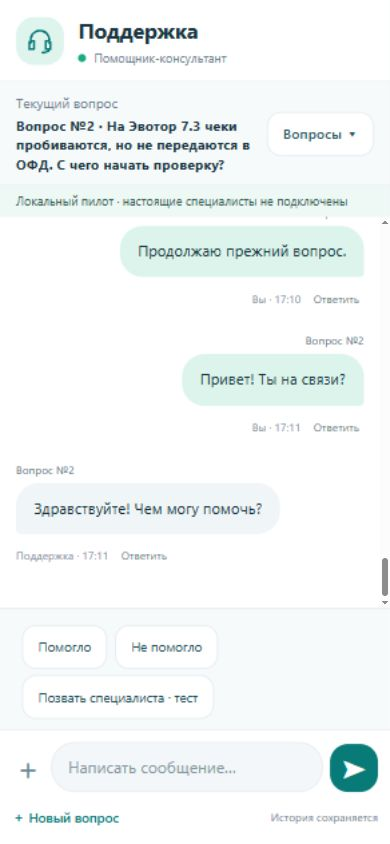
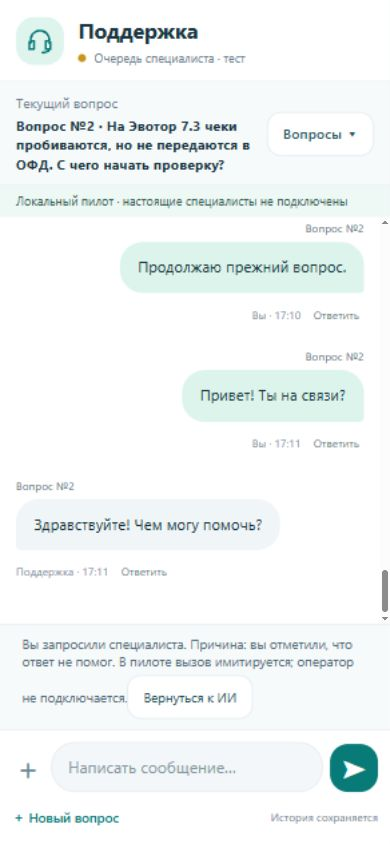

# Один бот с ИИ: Telegram/MAX и существующий Mini App

21.11.2026. Авторизация: аудит и ограниченные P0/P1 исправления подключения,
меню, чата, доставки и переключения интерфейсов. Уточнение владельца: это один
бот; остальную бизнес-логику большой CRM не расширять. LLM/KB/retrieval не менять.
Commit/push не разрешены. Работа продолжается поверх сохранённых local deltas
CRM d5f4c70 и RAG bedeca2; main checkout RAG — историческая документация интеграции.

## Карта подтверждённых проблем до исправлений

| Приоритет | Факт | Подтверждение / ограничение |
|---|---|---|
| P0 | После тестового вызова специалиста ИИ больше не обрабатывает продолжение того же вопроса; оператора в пилоте нет | Изолированный MySQL: case 7 open/queue/без owner; последние 4 клиентских сообщения routed в него, новых AI attempts нет. Последние attempts 10/11 answered/rag_clarify, receipt accepted/failures=0. Immutable private snapshot RAG `.local/hybrid-20261121-before/crm/tables.json` |
| P0 | Возврат к ИИ в том же вопросе не предлагается | client service/controller/API/JS не имеют такого действия; есть только Новый вопрос |
| P1 | Повторная доставка native event и открытие /chat повторно печатают последние 5 сообщений | client_bot.card(include_history=True) по умолчанию; duplicate branches вызывают card без изменения параметра |
| P1 | Native support удаляет исходные клиентские сообщения и перерисовывает карточку как экран меню | bot/support_client.py tg_text вызывает delete_answered_user_text и tg_send через TelegramUIFlow; неудобно для полноценной native переписки |
| P1 | «ИИ готовит ответ» выводится по отсутствию ответа, без проверки реального AI attempt | client.snapshot: last_client > last_answer; пустое новое обращение/terminal attempt могут отличаться от реальной обработки |
| P2 | Лишние deleteMessage400 при cleanup меню | private pilot trace: один target удаляется дважды; доставка карточки sendMessage200 успешна. Не причина остановки ИИ |

Нет доказательств, что молчание после handoff вызвано сбоем LLM/API. До handoff
последние RAG вызовы отвечали; очередь является намеренной блокировкой ИИ.
Скриншоты в текущем вложении отсутствуют: визуальные выводы требуют новой проверки
существующего интерфейса. Исторические screenshot reports не считаются свежим runtime.

## Владение состоянием

Native Telegram/MAX → Smart Navigation v4 (меню/магазин либо support) →
MySQL intake/router → case + ordered messages + durable AI attempt → RAG API →
receipt → assistant message + native outbox → API ack. Mini App пишет в тот же
intake и читает тот же ordered feed. CRM владеет mode/status/доставкой, RAG —
памятью и ревизией своего диалога; API ack означает публикацию в CRM, а не Telegram delivery.
queue и human блокируют AI claim; human не должен автоматически возвращаться к ИИ.

## Выполненные ограниченные исправления

1. `MySQLClientService.resume_assistant` и native/API/JS действие «Вернуться к ИИ»:
   только явный выбор клиента, текущий open/waiting_client case в queue, проверка
   ревизии под chat lock, запрет при human/активном звонке/transfer. Команда
   идемпотентна. Case и история прежние; старые AI attempts ограждены новой
   ревизией, queued messages не воспроизводятся как новые обращения к модели.
2. Возврат использует прежний `select_context/_update_context`: обновляет
   подтверждённый контекст после долгого отсутствия. Старые неоднозначные
   сообщения остаются на review через прежний механизм context_superseded,
   не классифицируются задним числом и не генерируют неожиданные ответы.
3. Snapshot передаёт mode/state/can_resume_ai. «ИИ отвечает» зависит от настоящего
   pending/processing attempt текущей ревизии, а не только от отсутствия текста.
   При двух быстрых сообщениях первый ответ не включает преждевременную оценку,
   пока второй attempt не завершён. Пустой новый вопрос не выдаётся за генерацию.
4. Native card не печатает пять старых сообщений при открытии, выборе или replay.
   Повторный native event не отправляет новую карточку. Обычное подтверждение
   короткое, без полного меню; ссылки и действия handoff/clarification сохранены.
   В текущем чате клиентские реплики сохраняются; отдельно исправлен общий cleanup
   первой реплики, которая только переводит Smart Navigation в поддержку.
5. Очередь, реальное принятие специалистом и пилотная заглушка различаются.
   Пилотная надпись больше не утверждает «ИИ работает» во время queue. При
   clarification интерфейс прямо сообщает, что сообщение ещё не передано ИИ;
   варианты используют уникальные названия вопросов, а не одинаковое «Новый вопрос».
6. После терминального сбоя RAG durable recovery публикует одно системное
   уведомление в общей истории и существующем native outbox. Это не AI ответ.
   Явный `notify_client=True` в прежнем append_message разрешён только SYSTEM;
   запись и outbox атомарны. Crash/replay не создаёт второе уведомление.
7. TelegramUIFlow больше не планирует удаление старого screen дважды. Старое
   меню удаляется один раз после успешного нового send; профиль/магазин/платежи
   и protected keyboard продолжают использовать тот же lifecycle.

Новых чатов, router, model stages, заявочной системы или RAG pipeline нет.
Ранее незакоммиченные изменения коллеги/пилота сохранены; правки над ними локальны.

## Состояния и разрешённые переходы

| Состояние | Что происходит | Действие / переход |
|---|---|---|
| assistant / ready | Новый вопрос или явное возвращение; генерация ещё не запущена | Новый текст → durable pending attempt |
| assistant / ai_responding | Pending/processing attempt текущей ревизии | Результат → waiting_client; ошибка → queue + status notice |
| assistant / waiting_client | Ответ сохранён, ждём продолжения/оценки | Текст → следующий attempt; «Помогло» → resolved; «Не помогло»/специалист → queue |
| queue / specialist_waiting | ИИ приостановлен, ответственного человека ещё нет | Текст сохраняется без LLM; явный возврат → assistant; принятие сотрудником → human |
| human / specialist_connected | Активный специалист назначен; ИИ не вмешивается | Штатные действия staff; клиент не может принудительно вернуть этот case к ИИ |
| human / specialist_unavailable | Назначенный специалист недоступен | Статус объясняет остановку; доступны новый вопрос и штатный staff review |
| resolved / archived | Генерация выключена, история сохранена | Новый вопрос или существующий контролируемый reopen/feedback |
| clarification / review | Сообщение сохранено, адресат не определён | Явно выбрать существующий вопрос или новый; до выбора не обещать AI ответ |

`mode` и `status` независимы: queue не означает, что человек подключился.
Возврат к ИИ не переносит текущую цель в другой case и не отменяет safety RAG.
Сообщения, написанные только в queue, видны в CRM/feed, но не отправлялись в
модель: их важные новые факты нужно повторить следующим сообщением после возврата.
Это явно ограниченный контракт без скрытого повторного проигрывания истории.

## Проверки и отрицательные результаты

| Проверка | Результат / границы |
|---|---|
| Полный CRM unit suite, финальный код | **422 passed / те же 2 Windows failures / 38 subtests**. Failures: chmod precision и отсутствующая symlink privilege. [Лог](tests/unit-final.txt) |
| Полный отдельный MySQL integration suite | **137 passed / 10 subtests**, 153.21 s. Изолированная crm_rag_ci, background worker её не обслуживает. [Лог](tests/mysql-final.txt) |
| Дополнительные длинный ответ + реальный HTTP timeout | **2 passed**. История содержит весь текст, native отправляет один ограниченный preview; настоящий socket timeout RagClient даёт 3 одинаковых input replay, затем failed и 1 system notice, без выдуманного AI ответа. Локальный HTTP fixture, не сбой production RAG. [Лог](tests/long-timeout.txt) |
| Native/menu/UI профиль до финального first-turn cleanup | **132 passed**; последний first-turn regression входит в full unit выше. [Лог](tests/native-profile.txt) |
| Живой RAG после возврата | Синтетический case2: «Привет! Ты на связи?» → «Здравствуйте! Чем могу помочь?», **4.837299 s**, answered, accepted, failures0. Один завершённый реальный RAG ход; не quality benchmark. [Receipt](live-result.json) |
| Mini App 390×844 | Живые HTTP/MySQL: queue → resume; «Не помогло» → очередь с client reason → resume; новый пустой case8; выбор прежнего case2 после service restart. **18 messages /18 unique IDs**, overflow=false |
| Runtime | Support10756/launcher6044, один polling worker10960/launcher23140,77/77 source hashes каждого совпадают; getMe/getUpdates200; API прежний17808, authenticated ready OK/state OK/index green, inflight0. [Receipt](runtime-final.json) |
| Статические проверки | JS syntax и git diff --check прошли; старые line-ending warnings Git не являются diff errors |

Первый полный MySQL проход:134 PASS/1 FAIL. Прежняя UI fixture вставляла ответ
вручную, оставляя attempt pending; после проверки реального pending state это
больше не соответствует завершённому ходу. Fixture переведена на настоящий
RagAIWorker с явно offline contract provider, ожидания состояния не ослаблены.
45 профильных PASS подтвердили её вместе с новыми transitions.

Первый живой resume старого case6 сменил mode, но следующий текст попал в
context_expired clarification: AI attempt не создавался. Это отрицательный
результат, не LLM failure/PASS. Причина исправлена через прежний context selection,
9 MySQL regressions PASS; финальный full suite выше содержит исправление.
В интерфейсе обнаружены одинаковые подписи clarification options — исправлены
уникальными labels. Старое спорное сообщение при явном выборе case2 осталось
сохранено в нём; автоматического LLM replay в queue не было.

Первый unit проход выявил два старых ожидания повторной native карточки; они
обновлены под явное требование владельца не дублировать UI. Две исторические
Windows ошибки не скрыты и не помечены PASS. Read-only diagnostic helper сначала
ошибся именем колонки события; исправлен без изменения schema. Один ручной
shell probe не выполнился из-за quoting, заменён отдельным Python helper.
Private initial full snapshot сохранён неизменным. Производный audit-before
helper один раз перезаписал свой summary; последующие evidence имена уникальны,
исходный full snapshot и RAG SQLite backup не перезаписывались.

## Матрица требуемых сценариев

| Сценарий | Подтверждено сейчас |
|---|---|
| Вопрос ИИ непосредственно Telegram | Native handler regressions; свежий polling200. Новый реальный пользовательский вход/ответ после этой delta **ещё нужен** |
| Продолжение Telegram → Mini App | Реальный общий MySQL/feed и прежняя смешанная история; новая browser проверка общего case. Свежий парный owner replay ещё нужен |
| WebApp ответ → Telegram | Реальные message/outbox/ack; у synthetic account несуществующий TG ID, delivery **cancelled**, не delivery PASS |
| Несколько сообщений | Реальная MySQL: два pending inputs, независимые answers, поздняя оценка, idempotency |
| Длинный ответ | Реальная MySQL/outbox: весь текст в feed, один preview + ссылка. Полный длинный ответ нативно частями пока **не реализован** |
| Новый вопрос | Живой UI создал case8 без ложного «ИИ отвечает» |
| «Не помогло» / специалист | Живой UI/HTTP/MySQL; queue и причина client_feedback |
| Реального специалиста нет | Явная пилотная надпись, queue, без мнимого присоединения |
| Возврат к ИИ | Живой resume в прежнем case2 + настоящий RAG ответ; human takeover запрещён тестом |
| Магазин после консультации | Существующие v4 regressions, меню/заказы сохранены. Настоящие покупки не выполнялись; owner меню replay ещё нужен |
| Прежнее обращение | Живой выбор case2 после нового case8 и перезапуска; история сохранена |
| Ошибка/timeout API | Реальный HTTP socket timeout + MySQL/receipt/outbox; не имитация остановки работающего сервиса |
| Дубли/перезапуск | MySQL command/native/API replay, lease/recovery tests; реальный CRM restart и browser reopen без потери истории |

MAX проверен общими controller/route regressions; реальная MAX доставка и
настоящий staff acceptance в текущем локальном пилоте не подтверждены.
Loopback HTTP ссылка открывает этот ПК, а не телефон. Remote HTTPS Mini App
deployment остаётся отдельной проверкой окружения. При startup прежний OFD
catalog connector сообщил внешний HTTP400/пустой каталог; продажный provider
в этой задаче не перенастраивался и покупка ОФД не объявляется рабочей.

## Следующие шаги в том же интеграционном этапе

1. Личный Telegram/Desktop + Mini App replay ниже, затем точечная сверка trace,
   state/attempt/outbox. После него отдельное решение о production readiness.
2. Для полного длинного ответа в Telegram/MAX требуется согласовать доставку
   частями и per-part receipts/recovery/uncertain outcomes в существующем outbox.
   Это более крупное изменение контракта: пока только предложение, без внедрения.
3. Нужны проверка реального MAX, HTTPS из телефона и staff acceptance перед
   заявлением о полном production GO. Нет оснований заменять их unit тестами.
4. После принятия инфраструктуры вернуться к прежним RAG factual/context/symptom
   quality проблемам. LLM/KB/retrieval в этой итерации не изменены.

## Проверка владельца (тот же бот)

1. `/start` → «💬 Чат» или `/chat`. Если старый вопрос стоит в тестовой очереди,
   нажать «Вернуться к ИИ»; новый вопрос ради этого создавать не нужно.
2. Написать простой вопрос в Telegram. Клиентская реплика остаётся; нет повтора
   пяти старых сообщений. Дождаться ответа; открытие Mini App не обязательно.
3. «Открыть чат на этом ПК» в Telegram Desktop. Открыть тот же вопрос, продолжить
   из Mini App. Проверить один ответ, его порядок и доставку в Telegram.
4. «Не помогло» / «Позвать специалиста · тест»: увидеть очередь и честное
   отсутствие оператора. «Вернуться к ИИ» → написать следующее сообщение.
5. «Новый вопрос» → написать независимый вопрос. «Вопросы» → старый вопрос;
   проверить историю. Закрыть/открыть Mini App — выбранный case и сообщения прежние.
6. В Telegram перейти в магазин, затем `/chat` → прежний вопрос. Реальную
   оплату не делать; checkout в пилоте заблокирован.

Новых commit/push/merge нет. Ссылок на новые коммиты нет: это локальная delta
поверх опубликованных RAG bedeca2 и CRM d5f4c70, а не заявленная публикация.
Неизменённый пользовательский case7 оставлен в исходной queue, чтобы владелец
сам проверил новую кнопку; synthetic тесты его mode/историю не изменяли.

