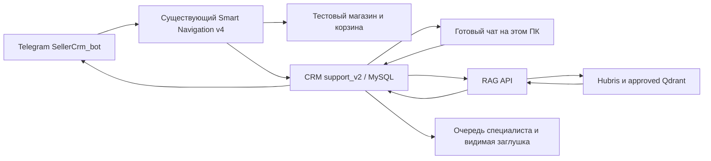
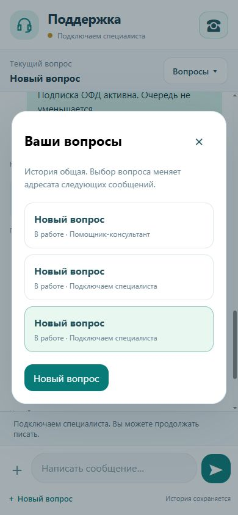
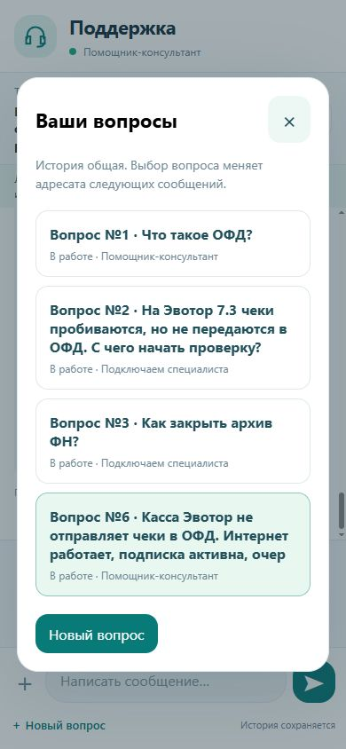
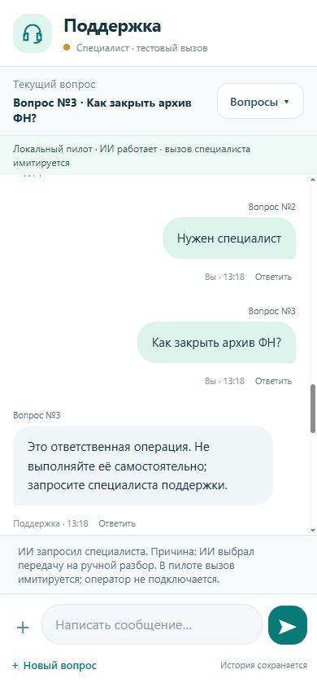
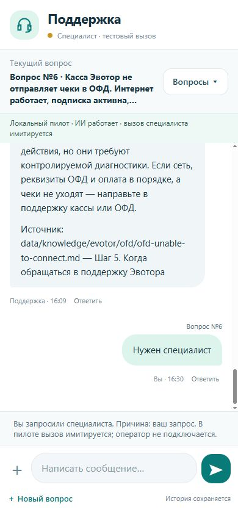

# Локальный стенд: существующий чат, общий ИИ и заглушка специалиста

2026-11-20. Владелец уточнил цель: локально проверять интерфейсы Telegram и
готового чата, ответы общего ИИ и переходы системы; реальных операторов пока
не подключать. Чат с нуля не создавался: изменены существующие
`webapp/templates/support_chat.html`, `webapp/static/support_chat.js/.css`,
`webapp/support_api.py`, `services/support/client.py`, `client_bot.py` в CRM.

## Фактическая схема

Веб-чат идёт непосредственно в существующий intake поддержки, без товарного
маршрутизатора. Идентификация через нативный бот выдаёт ссылку на тот же CRM
аккаунт и его общую историю; synthetic demo — другой, явно тестовый аккаунт.
Это локальный интеграционный стенд, а не подключение production CRM. Django
staff/admin и MAX end-to-end в этой проверке не запускались.

## Изменения и границы

- В пилоте `/chat` предлагает обычную HTTP-ссылку «Открыть чат на этом ПК».
  Telegram WebApp по HTTPS не подменён локальным HTTP: открытие происходит в
  браузере на том же компьютере. С телефона loopback ведёт на сам телефон.
  Существующие HTTPS WebApp-кнопки и поведение вне пилота сохранены.
- Чат показывает понятные названия обращений из первого клиентского сообщения
  и номера вопросов. Исходная тема и маршрутизация не переписаны.
- До ответа нет «Помогло / Не помогло»; показано ожидание ИИ. Новый клиентский
  ход снова убирает преждевременную оценку. После ответа оценка доступна.
- При выборе/открытии обращения чат прокручивается к его последнему сообщению;
  при необходимости использует существующую пагинацию. Общая история остаётся
  общей, сообщения других вопросов не удаляются. Открытый список не пересоздаётся
  каждые пять секунд без изменения данных. В сообщениях короткая метка вопроса,
  полное название — в заголовке и списке. Bold выводится через безопасные DOM
  text/strong, без исполнения HTML из ответа.
- Native подтверждение отправки больше не перепечатывает пять старых сообщений.
  Добавлены pilot controls выбора/создания вопроса, оценки и тестового вызова.
- `SUPPORT_PILOT_MODE=1` действует только с loopback `crm_rag_demo`. Видно,
  кто запросил специалиста: ИИ по реальному `case_escalated` или клиент по intake/
  feedback. Причина решения сохраняется в событии; RAG reason также сохраняется.
  Текст «обратитесь в поддержку» сам по себе не считается вызовом специалиста.
- В пилоте отключены scheduler уведомлений специалистам, ежедневные рассылки и
  HTTP создание звонка. Call worker не запускается. Очередь остаётся настоящим
  состоянием CRM, но подключение человека имитируется. Для следующего теста ИИ
  после передачи нужно создать новый вопрос.
- Consultation precedence расширен в существующем v4: просьбы помочь/разобраться
  идут в консультацию до товарного совпадения. Активная поддержка выходит в
  магазин только при утвердительном запросе покупки/просмотра. Наличие слова
  «ОФД»/подписки не является таким запросом. Два исходных route failures закрыты
  offline на независимых формулировках; owner LIVE replay ещё нужен.
- Product search и текстовая equipment card используют существующий UIFlow.
  Фото equipment и все исторические потерянные меню этим узким исправлением
  не объявлены исправленными. Массового удаления истории не было.

## Проверка и результаты

1. Через настоящий локальный интерфейс отправлен synthetic вопрос:
   «Касса Эвотор не отправляет чеки в ОФД. Интернет работает, подписка активна,
   очередь не уменьшается.» Native attempt завершён за **17.75 с**,
   `answered`, durable receipt `accepted`, failures 0. Ответ из approved
   `evotor/ofd/ofd-unable-to-connect.md` появился в браузере.
   Это один LIVE ход до UI-изменений на неизменённом RAG API, не общий quality PASS.
   Ответ перечисляет дополнительные условия EoU/реквизитов/доступности серверов;
   их фактическое подтверждение пользователем не доказано.
2. После изменений на viewport **390×844** проверены список обращений, выбор
   предыдущего вопроса с прокруткой, безопасный bold и сохранённая история.
   Старое реальное AI-escalated обращение корректно показывает заглушку ИИ.
   Кнопка «Позвать специалиста · тест» прошла настоящий HTTP intake и MySQL,
   показала «Вы запросили специалиста» без нового AI-вызова/оператора.
3. Unit final: **418 passed, 2 прежних Windows failures, 38 subtests passed**.
   Причины прежние: Unix permission bits и отсутствие symlink privilege.
   Первый запуск без test BOT_TOKEN добавил 2 import failures; повтор с явным
   фиктивным offline token их устранил. Это настройка harness, не исправление
   продукта и не использование реального токена в unit suite.
4. Реальная отдельная MySQL `crm_rag_ci`: **37 passed** (client + RAG adapters).
   После последних snapshot/event изменений ещё **2 passed**; targeted native/
   navigation/pilot profile **62 passed**. JS syntax и `git diff --check` пройдены.
   Первая новая fixture попыталась публиковать assistant без expected revision;
   штатный guard её отклонил. Fixture исправлена, guard сохранён.
5. Финальный runtime: support **20484**, один poller **21276**, API прежний
   **7560**. CRM base `d5f4c70` + локальные изменения, **77/77 hashes** каждого
   startup receipt совпадают. Health: pilot true/operator stub/RAG true/delivery
   true; authenticated RAG ready state OK/index green; getUpdates 200, inflight 0.
   Private receipt: CRM `.local/pilot-ui-runtime-final.json`. Предыдущий env-only
   helper не устанавливал launcher pilot flag и потому показывал false при true
   server health; сохранён как `pilot-ui-runtime-env-only.json`, исправленный
   helper воспроизводит явный launcher profile. Это не смена режима сервера.

Telegram новые кнопки/cleanup проверены unit и startup construction; новый ручной
Telegram Desktop replay с кликом loopback-ссылки владельцем ещё не выполнен.
Нативная доставка synthetic fake recipient не доказывает доставку реальному
пользователю. Скриншоты ниже относятся к synthetic аккаунту, без access tokens.

## Следующая проверка владельца

На этом ПК: Telegram Desktop → `/chat` → «Открыть чат на этом ПК».
Проверить один вопрос попеременно в Telegram и браузере, не создавать новый
между двумя каналами. «Новый вопрос» использовать только для независимого кейса
или возврата к ИИ после заглушки специалиста. Затем повторить [пробы](probes.md)
с новым tracing и оценить исчезновение лишних меню.

Качество symptom intake / readiness, прежние ошибки продолжения/концептуальных
ответов и полная полезность остаются открыты. В RAG app/model/approved KB эта
итерация ничего не меняла. Общий quality/production gate не пройден; работа
остаётся на текущем интеграционном этапе. Новых commit/push нет.
